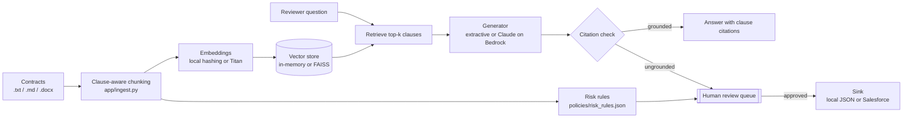

# AI Legal Contract Analyzer

> Governed retrieval-augmented generation (RAG) over legal contracts: clause-aware retrieval, cited answers, rule-based risk scoring, and a human review gate before anything is published.

[](https://github.com/gyaneshwarmalba/ai-legal-contract-analyzer/actions/workflows/ci.yml)

Runs fully offline out of the box (no API keys). Each external service, including AWS Bedrock for generation and embeddings, FAISS for the vector index, and Salesforce for publishing, is behind an interface and switched on in `.env`.

All contracts in `data/sample_contracts/` are synthetic and were written for this demo.

## Architecture



## What it does

| Capability | How |
|---|---|
| **Clause-aware ingestion** | Splits on the contract's own headings (`1. TERM`, `Section 4`, `ARTICLE III`), so every chunk is a real clause and every citation is a section number. |
| **Cited answers** | The generator only sees retrieved clauses and must cite them as `[n]`. Answers that cite nothing, or cite a clause that wasn't retrieved, are marked ungrounded and sent to review. |
| **Honest refusals** | If nothing relevant is retrieved, the system says so instead of guessing. |
| **Risk scoring** | Versioned JSON rules (liability caps, one-sided indemnity, termination for convenience, auto-renewal, data use, subcontracting, and more), each with evidence text, an explanation, and a recommended fallback position. |
| **Human in the loop** | Every risk report goes to a review queue. Only approved items are published (to local JSON or a Salesforce custom object). |
| **Two front ends** | FastAPI (`/docs` for OpenAPI) and a Streamlit reviewer UI. |

## Quick start

```bash
git clone https://github.com/gyaneshwarmalba/ai-legal-contract-analyzer.git
cd ai-legal-contract-analyzer
python -m venv .venv && source .venv/bin/activate
pip install -r requirements.txt

uvicorn app.main:app --reload              # API at http://localhost:8000/docs
streamlit run ui/streamlit_app.py          # reviewer UI
pytest                                      # 25 tests, all offline
```

Example:

```bash
curl -s localhost:8000/ask -H 'content-type: application/json' \
  -d '{"question": "How long do confidentiality obligations last?", "contract_id": "globex-mutual-nda"}'
# "Confidentiality obligations survive for three (3) years after termination. [1]"
# citations: globex-mutual-nda §5 Term

curl -s localhost:8000/contracts/acme-master-services-agreement/risk
# score 100/100 (high): uncapped liability, one-sided indemnity, provider termination for convenience, ...
```

## API

| Method | Path | Purpose |
|---|---|---|
| GET | `/health` | Active providers, index size, policy version |
| GET / POST | `/contracts` | List or add a contract (`{name, text}`) |
| GET | `/contracts/{id}/clauses` | Parsed clauses |
| GET | `/contracts/{id}/risk` | Risk report (queued for review) |
| POST | `/ask` | `{question, contract_id?, k?}` returns an answer with citations |
| GET | `/reviews?status=pending` | Review queue |
| POST | `/reviews/{id}/decision` | `{approve, reviewer, note?}`; approval publishes to the sink |

## Switching to cloud services

```bash
pip install -r requirements-cloud.txt
cp .env.example .env
```

| Setting | Values | Notes |
|---|---|---|
| `LLM_PROVIDER` | `local`, `bedrock` | Claude through the Bedrock Converse API, temperature 0, with a citation-only system prompt |
| `EMBEDDINGS_PROVIDER` | `local`, `bedrock` | Amazon Titan Text Embeddings v2 (1024 dimensions, normalised) |
| `VECTOR_STORE` | `memory`, `faiss` | FAISS `IndexFlatIP` over normalised vectors (cosine similarity) |
| `RESULT_SINK` | `local`, `salesforce` | Creates a `Contract_Analysis__c` record per approved review |

AWS credentials come from the standard boto3 credential chain (SSO profile or IAM role); no keys are stored in code. The Salesforce sink expects a custom object with the fields `Contract_Key__c`, `Review_Kind__c`, `Risk_Score__c`, `Risk_Level__c`, `Reviewer__c`, `Reviewer_Note__c`, and `Details_JSON__c` (long text area).

## Design decisions

- **Extractive generator as the offline baseline.** It can only quote retrieved text, so it never hallucinates. That makes it a useful control when evaluating a hosted model against the same retrieval results.
- **The citation check is enforced in code, not only in the prompt.** Prompts ask for citations; `pipeline.ask` verifies them and routes failures to a human.
- **Risk rules are data.** Legal owns `policies/risk_rules.json` (versioned, with `match`/`unless` patterns), and every report records the policy version it was scored against.
- **Rules first, LLM second.** Deterministic rules give repeatable, auditable risk scores. An LLM is better used to explain or draft redlines than to decide the score.
- **Publishing requires approval.** The sink is only called from `decide(approve=True)`, so there is no code path that writes to Salesforce without a reviewer.

## Project layout

```
app/
  ingest.py        clause-aware chunking, .txt/.md/.docx loading
  embeddings.py    hashing embedder (offline) and Titan embedder
  vectorstore.py   in-memory and FAISS stores
  llm.py           extractive and Bedrock generators, citation parsing
  risk.py          policy loading and clause scoring
  review.py        persistent review queue (atomic JSON writes)
  sinks.py         local JSON and Salesforce publishers
  pipeline.py      ContractAnalyzer: wires everything together
  main.py          FastAPI app
ui/streamlit_app.py
policies/risk_rules.json
data/sample_contracts/   synthetic MSA, NDA, SaaS agreement
tests/
```

## Limitations

- The hashing embedder is lexical. It handles paraphrase poorly compared with Titan embeddings, and that gap is the reason the Bedrock option exists.
- Indexes are in memory and rebuilt at startup. A production deployment would persist them in a managed vector store.
- Risk rules are pattern-based and tuned to the sample contracts. Real use needs a rule set and regression corpus owned by legal.

## License

MIT. See [LICENSE](LICENSE).
